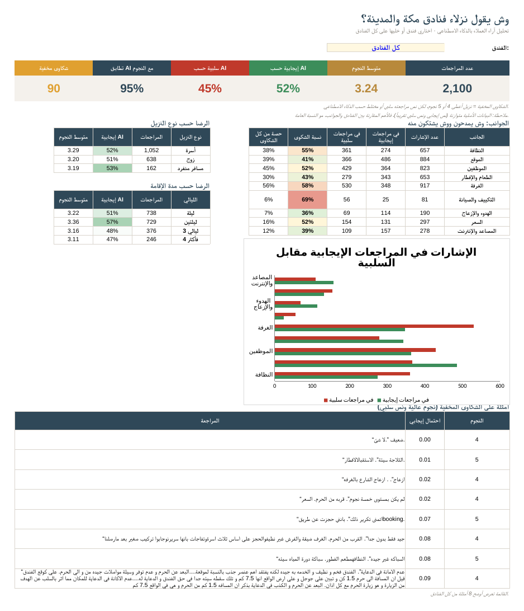
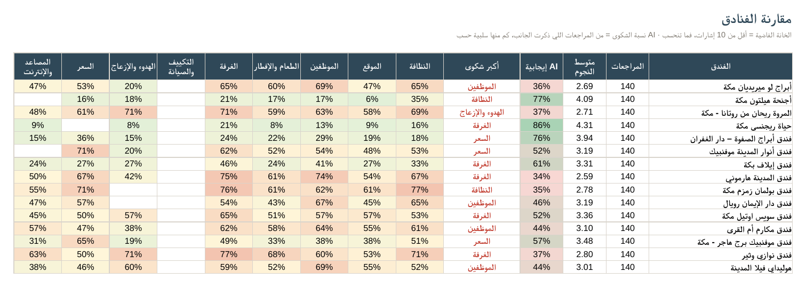

# What do hotel guests in Makkah & Madinah actually complain about?

Star ratings tell you *if* guests are happy, not *why*. I took 2,100 Arabic reviews of the 15 most-reviewed hotels in Makkah and Madinah, used a small AI model to read the sentiment of each review, and then did all the analysis in Excel.

📊 [Excel workbook](Hotel_Reviews_AI_Analysis.xlsx) · 🤖 [AI step (notebook)](hotel_reviews_ai.ipynb)

## How I did it
**1. The AI part (Python, one short notebook).** I trained a sentiment model on ~100K other Arabic hotel reviews: TF-IDF on character n-grams + logistic regression. I used characters instead of words because the reviews mix dialects and spellings ("نظافه" vs "نظافة"). It reached **~94% accuracy** on reviews it had never seen. For each review it gives a probability that the text is positive.

**2. The Excel part (everything else).**
- The probability becomes a label: positive, negative, or *mixed* when the review praises and criticises at the same time. The thresholds are editable.
- **Topics** are detected with Excel formulas (`SEARCH` over a keyword list per topic: cleanliness, location, staff, food, room, AC & maintenance, quiet/noise, price, lifts & Wi-Fi). The keywords sit in their own sheet so anyone can tweak them.
- A dashboard with a hotel dropdown, a topic table, satisfaction by traveller type and length of stay, and a **hotel × topic heatmap**.

## What I found
- **The room is the #1 complaint.** 56% of negative reviews mention the room, and when a review talks about the room it's negative 58% of the time.
- **Location is what hotels get right.** It's mentioned a lot, but mostly positively, which makes sense when you're close to the Haram.
- **AC and maintenance are rare but almost always bad news:** 69% of the reviews that mention them are negative.
- **Longer stays are less happy:** about 57% positive for two-night stays vs ~47% for four nights or more.
- **Hidden complaints:** 90 guests gave 4–5 stars but wrote a negative or mixed review. Stars alone would miss them.

## Notes
- The data is the public **HARD (Hotel Arabic-Reviews Dataset)**, collected from Booking.com in 2016. It's balanced (roughly half positive, half negative), so I focus on comparing hotels and topics, not on the overall percentage.
- No dates in the data, so no trend over time.
- The keyword topics are simple on purpose. A next step would be an aspect-based model, which is what my MSc project was about.

---
Sarah Alkathiri · [Portfolio](https://sarahalkathiri.github.io)
