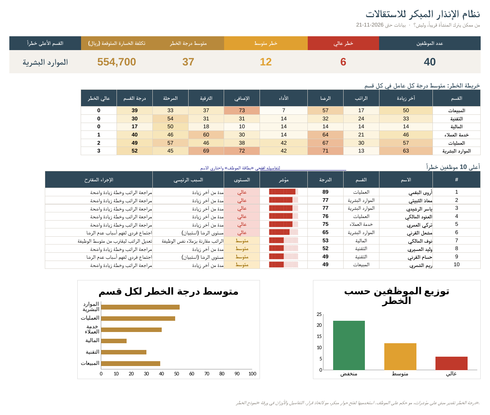
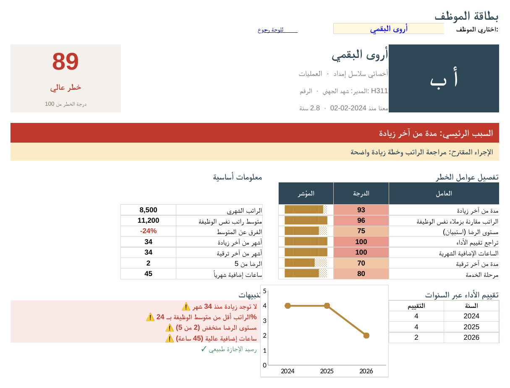

# Who's about to quit? An attrition early-warning system in Excel

HR usually finds out someone is unhappy when the resignation letter arrives. I wanted to flip that: spot the warning signs early, explain *why* each person is at risk, and suggest what a manager can actually do about it. All in Excel, so any HR team can open it.

📊 [Download the workbook](HR_Attrition_Early_Warning.xlsx) (sample company, made-up names)

## How it works
Every employee gets a **risk score from 0 to 100**, built from seven signals that show up again and again in retention research:

| Signal | Scores 100 when… |
|---|---|
| Time since last raise | 36+ months without a raise |
| Pay vs peers in the same role | 25%+ below the role average |
| Satisfaction (survey 1–5) | Score of 1 |
| Performance drop | Rating fell 2 points vs last year |
| Overtime | 40+ hours a month |
| Time since last promotion | 48+ months |
| Career stage | Highest risk between 1 and 3 years in |

Each signal has a weight (you can change them in the model sheet), and the score is the weighted sum. The **main reason** is the signal that adds the most to that person's score, and it comes with a suggested action.

## What's in the file
- **Dashboard:** high / medium / low counts, the expected cost of losing the at-risk people, a heatmap of departments × signals, and the top 10 people to talk to first.
- **Employee card:** pick a name and get a profile: risk score, main reason, a breakdown of all seven signals with in-cell bars, salary vs the role average, performance trend and alerts.
- **Model sheet:** weights, thresholds and the cost assumption, so it's not a black box.

## Why rules and not machine learning (yet)
With my AI background the obvious move was a model, but you can't train one without real history of who actually left. So I went with a transparent, rule-based score that HR can read and argue with. Once a company has a year or two of exit data, the same seven signals become the features for a proper classifier, and the weights can be learned instead of set.

## A note on using it
A risk score is a reason to have a conversation, not to make a decision about someone.

**Built with:** `SUMPRODUCT`-style weighted scoring, `AVERAGEIFS` for peer benchmarks, `INDEX/MATCH` + `LARGE` for the live top-10, `REPT` in-cell bars, conditional formatting and charts. No macros.

---
Sarah Alkathiri · [Portfolio](https://sarahalkathiri.github.io)
