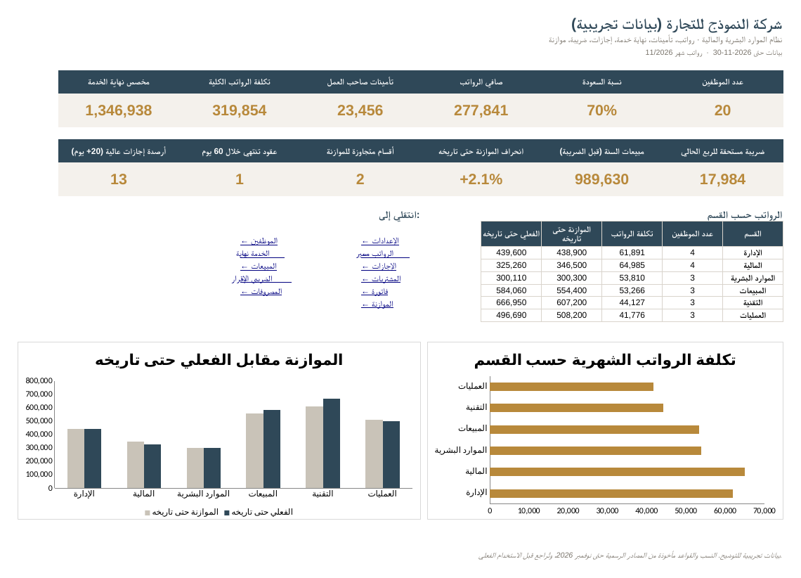

# Saudi HR & Finance system in Excel

A lot of small companies in Saudi still run payroll, GOSI, end of service and VAT in separate spreadsheets that don't talk to each other. I wanted one workbook where everything connects: add an employee once, and their payroll, social insurance, leave balance and end-of-service provision all update.

📊 [Download the workbook](Saudi_HR_Finance_System.xlsx) (the data inside is a made-up sample company)

## What's inside
| Sheet | What it does |
|---|---|
| **Dashboard** | Headcount, Saudization rate, payroll cost, GOSI, end-of-service provision, VAT due, budget variance and alerts |
| **Settings** | Company info, GOSI rates, VAT rate, leave days, lists. Everything else reads from here |
| **Employees** | Employee records, years of service, contract end alerts, annual leave entitlement |
| **Payroll** | Monthly payroll with overtime, absence deductions, employee and employer GOSI, net pay and total cost |
| **End of service** | Calculator by employee, end date and reason (termination, contract end, resignation), plus the total provision |
| **Leave** | Leave log and remaining annual leave per employee |
| **Sales / Purchases** | Invoice registers with 15% VAT |
| **VAT return** | Output VAT minus input VAT per quarter |
| **Invoice** | Pick an invoice number and get a printable tax invoice |
| **Expenses / Budget** | Expense log, monthly budget per department, budget vs actual, variance and year-end forecast |

## The rules I built in
- **GOSI:** Saudis on the old system (registered before 3 July 2024) pay 9.75% and the employer 11.75%. Saudis on the new system pay 10.75% and the employer 12.75% from July 2026. Non-Saudis: 2% occupational hazards on the employer only. Calculated on basic + housing, capped at SAR 45,000.
- **End of service (Articles 84 & 85):** half a month per year for the first five years, a full month after that. On resignation: nothing under 2 years, a third up to 5, two thirds up to 10, full after 10.
- **Overtime (Article 107):** hourly wage plus 50% of the basic hourly wage.
- **Annual leave (Article 109):** 21 days, 30 after five years.
- **VAT:** 15%.

All rates are in the Settings sheet so they can be updated, since the new-system GOSI rate goes up every July until 2028.

## Excel skills used
`SUMIFS`, `INDEX/MATCH`, `SUMPRODUCT`, data validation dropdowns, conditional formatting alerts, cross-sheet links and charts. No macros, so it works anywhere.

*This is a template for learning and small businesses. Check the official GOSI and HRSD rules before using it for real payroll.*

---
Sarah Alkathiri · [Portfolio](https://sarahalkathiri.github.io)
