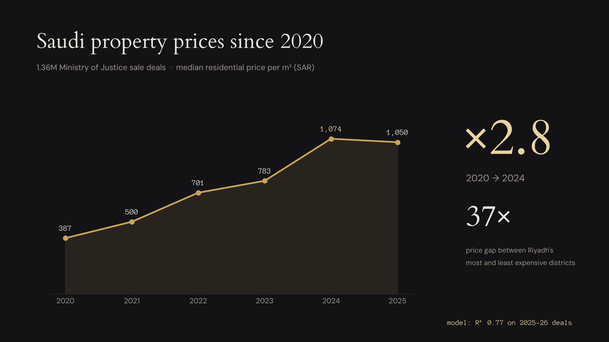
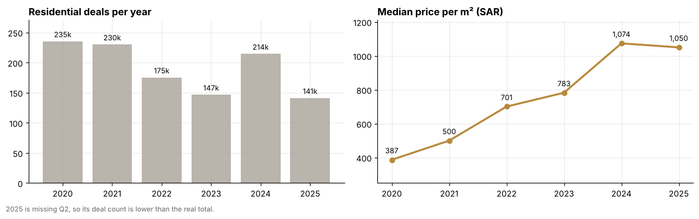
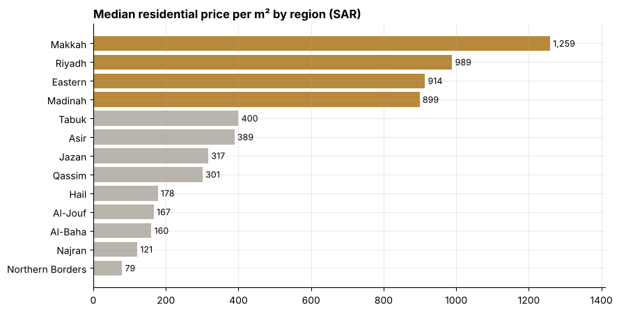
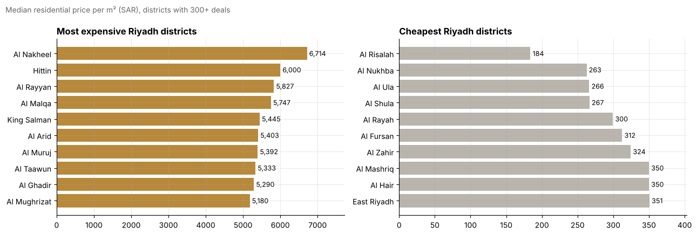
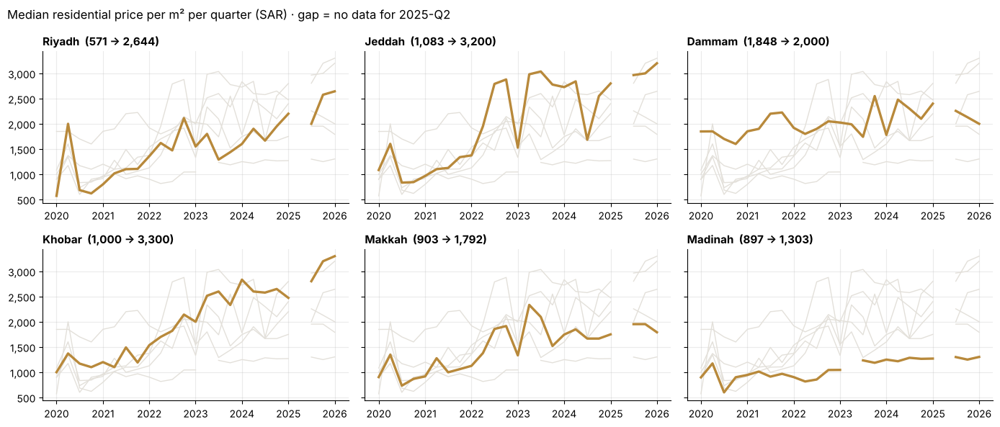
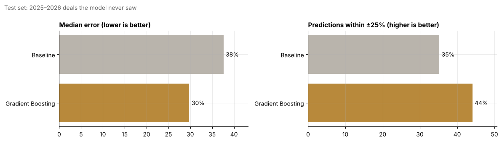

# Saudi property prices since 2020

I wanted to see what's really happening with property prices in Saudi Arabia, using the actual sale deals registered at the Ministry of Justice instead of headlines. That came to about **1.36 million deals** from 2020 to early 2026, across 13 regions, 174 cities and 11,000+ districts.

📓 [Notebook](saudi_real_estate.ipynb) · [Open in Colab](https://colab.research.google.com/github/SarahAlkathiri/sarahalkathiri.github.io/blob/main/projects/saudi-real-estate/saudi_real_estate.ipynb)

## What I found

**Prices almost tripled.** The median residential price per m² went from about 390 SAR in 2020 to about 1,070 SAR in 2024. That held even in 2022–2023, when the number of deals dropped.

**Four regions are in a different league.** Makkah, Riyadh, Eastern and Madinah are the only regions above 800 SAR/m². Northern Borders is under 80.

**Inside Riyadh the gap is huge.** The most expensive district (Al Nakheel, ~6,700 SAR/m²) is about 37 times the cheapest one. The expensive districts are all in the north, but most deals actually happen on the edges of the city (Al Khair, Uraid, Namar).

**Riyadh, Jeddah and Khobar rose the most.** Dammam stayed around 2,000 and Madinah was the calmest market.

## The model
I trained a gradient boosting model to predict price per m² from location, area, property class and date. I trained it on 2020–2024 and tested it on 2025–2026 deals it never saw, since that's how it would be used in real life.

| | Baseline (district median) | My model |
|---|---|---|
| R² (log price) | 0.68 | **0.77** |
| Median error | 38% | **30%** |
| Within ±25% | 35% | **44%** |

Location matters more than anything else. The district's price level was by far the strongest feature.

A 30% error isn't small. The main reason is that the data doesn't say whether a deal is land, an apartment or a villa, so the model can't tell them apart in the same district. It works as an estimate of an area's price level, not as a valuation of a specific property.

## Things I ran into
- Column names change between files (2023 especially), and region names are spelled more than one way. I wrote a loader that standardises everything first.
- The file labelled **2025-Q2 is actually a copy of 2024-Q2**, so there's no real data for that quarter. I only noticed it because of duplicate reference numbers.
- With 11,000+ districts I couldn't one-hot encode them, so I used out-of-fold target encoding to avoid leakage.

## What I'd do next
- Bring in the Real Estate General Authority data, which has property types, to separate apartments from land.
- Predict the change in price instead of the price itself, so the model can handle the upward trend.
- Build an interactive Power BI dashboard by district.

## Source
Ministry of Justice (وزارة العدل) sales data, published on the Saudi Open Data Portal ([open.data.gov.sa](https://open.data.gov.sa)) under the KSA Open Data License. I used the consolidated copy in [civillizard/saudi-real-estate-data](https://github.com/civillizard/saudi-real-estate-data). The raw data isn't included here; the notebook downloads it.

---
Sarah Alkathiri · [Portfolio](https://sarahalkathiri.github.io)
