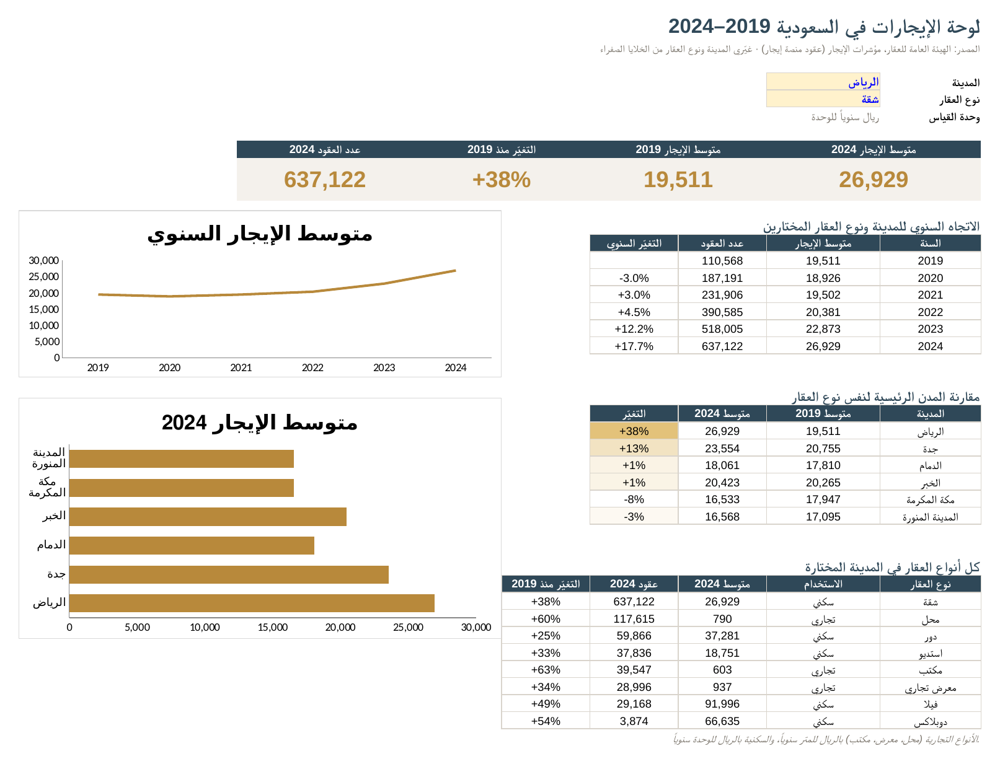

# Saudi rents 2019–2024: an Excel dashboard

After looking at property **sale** prices in my [real estate project](../saudi-real-estate), I wanted the other side of the market: how much people actually pay in rent, and how that changed. I built this one fully in Excel.

📊 [Download the workbook](Saudi_Rental_Dashboard.xlsx)

## The data
Rental indicators from the Real Estate General Authority (REGA), based on contracts registered on Ejar. 13 files (one per region), about 20,000 rows: year, quarter, region, city, property type, number of contracts and the average rent.

## How I built it
- **Power Query** to combine the 13 files. The column headers weren't consistent (some Arabic, some English, some with extra spaces), so the normal "combine files" option mixed up the columns. I skipped each file's header row and named the columns myself. The M code is in [rental_query.m](rental_query.m) and in the Notes sheet.
- Cleaned extra spaces, fixed regions written two ways, and split the property type into unit (apartment, villa, shop…) and use (residential / commercial).
- **Weighted averages.** Each row is already an average, so averaging the averages would give a small town with 2 contracts the same weight as Riyadh with 600k+. Every number in the dashboard is `SUM(contracts × avg rent) / SUM(contracts)` with `SUMIFS`.
- **Dashboard** with dropdowns for city and property type. The KPIs, yearly trend, city comparison and charts all update from those two cells.

## What I found
- **Riyadh apartments went up 38%**, from about 19,500 SAR a year in 2019 to 26,900 in 2024. Most of that happened in 2023 and 2024.
- **Jeddah rose 13%**, while **Dammam and Khobar barely moved** (about +1%).
- **Makkah and Madinah apartments are actually cheaper** than in 2019 (−8% and −3%).
- The number of registered rental contracts grew a lot over the period, so part of the early years may be under-covered by Ejar.

## Notes
- Residential rents are the average **annual rent per unit**. Commercial ones (shops, showrooms, offices) are **annual rent per m²**, so they shouldn't be compared directly.
- Some small cities have only a handful of contracts, so their averages jump around.

## Source
Real Estate General Authority (الهيئة العامة للعقار), rental indicators, published on the Saudi Open Data Portal ([open.data.gov.sa](https://open.data.gov.sa)) under the KSA Open Data License.

---
Sarah Alkathiri · [Portfolio](https://sarahalkathiri.github.io)
