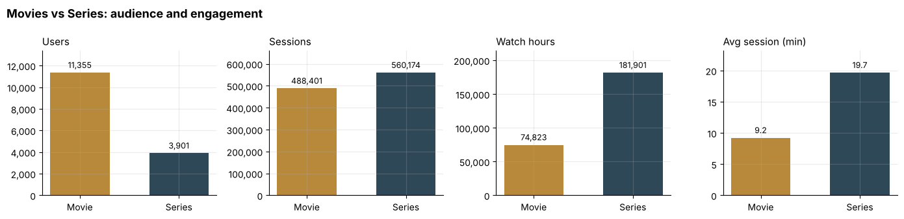
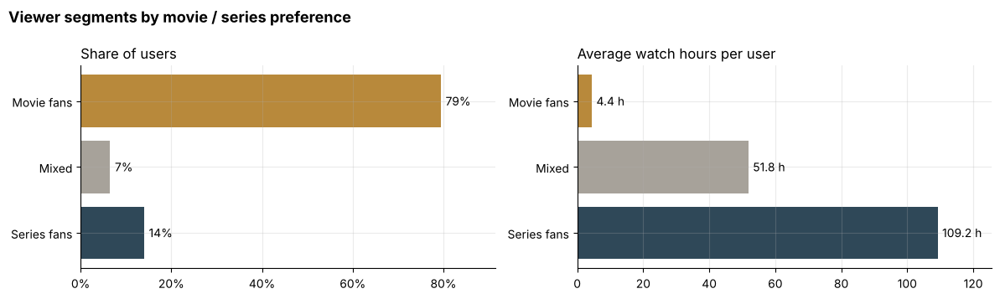
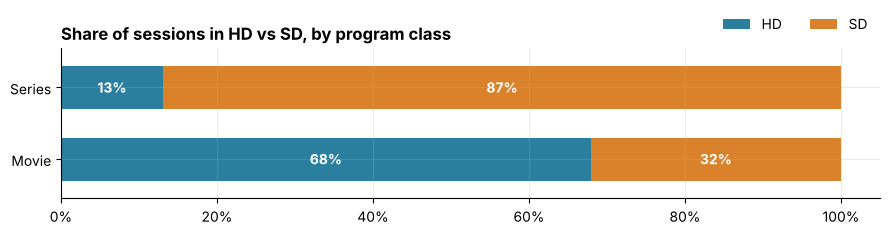

# stc tv: who's actually watching?

I wanted to understand how people use stc tv: who watches movies vs series, who watches in HD vs SD, and whether those groups behave differently.

The data has about **1M viewing sessions** from **11,578 users** between March 2017 and April 2018. I did everything in Python (pandas + matplotlib) on Google Colab.

📓 [Notebook](stc_tv_analysis.ipynb) · [Open in Colab](https://colab.research.google.com/github/SarahAlkathiri/sarahalkathiri.github.io/blob/main/projects/stc-tv-analysis/stc_tv_analysis.ipynb)

## What I found

**Almost everyone tries movies, but series are what keep people watching.** 98% of users watched at least one movie, while only 34% watched series. Still, series make up 71% of all watch hours.

**A lot of movie viewing is just browsing.** The median movie session is 1.3 minutes. For series it's 18 minutes.

**A small group carries the platform.** When I split users by what they prefer, "series fans" were only 14% of users but 69% of watch hours. "Movie fans" were 79% of users, and half of them watched less than 9 minutes in total.

**HD vs SD isn't really the user's choice.** I expected people to pick the quality, but 97% of programs only exist in one quality. 68% of movie sessions are HD, while only 13% of series sessions are.

**So the most loyal viewers end up watching in SD.** The SD group (14% of users) averages 79 hours of watching. The HD group (53%) averages under 2 hours, and almost all of it is movies.

## What I'd recommend
1. Bring the series catalogue to HD, since the most engaged viewers are the ones stuck in SD.
2. Work on the people who open a movie and leave within a minute or two: better recommendations, shorter trailers, "continue watching".
3. Keep investing in kids' animation. It's the top genre in every group.

## A few notes on the data
- I can't share the dataset here; it was provided for this task.
- The file has exactly 1,048,575 rows, which is Excel's row limit, so it's probably cut from a bigger export.
- Some program names are missing letters (e.g. "The Amazing pider-Man"), so I kept titles as they are.
- I left out sessions longer than 4 hours (0.7%) when calculating durations. One was 17 days long, which is clearly a TV left on.

---
Sarah Alkathiri · [Portfolio](https://sarahalkathiri.github.io)
