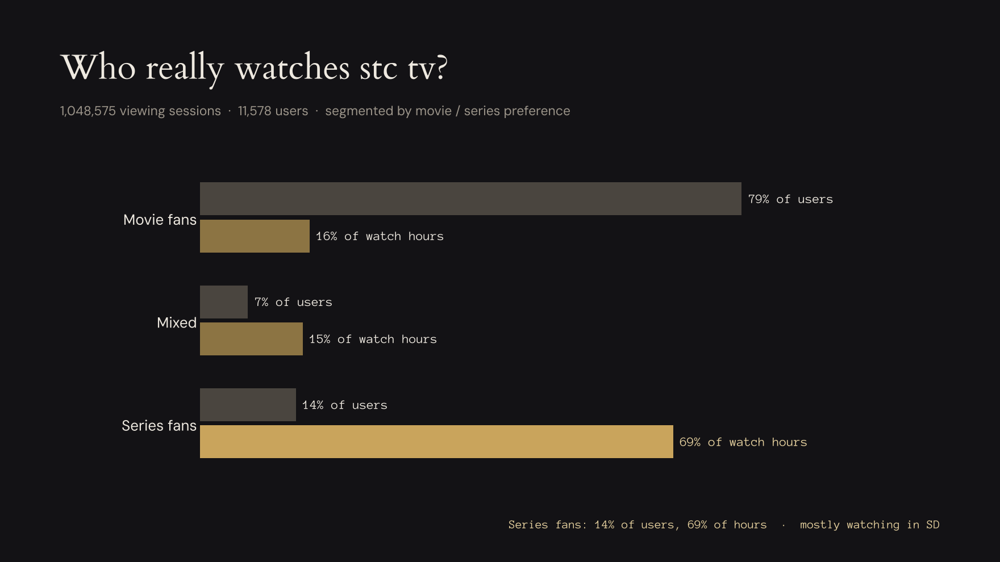
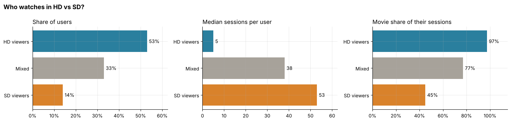

# stc tv — Viewer Behaviour Analysis | تحليل سلوك مشاهدي stc tv

**Goal:** understand how stc tv users watch, by **program class** (movie / series) and by **video quality** (SD / HD), and turn it into content recommendations.

**Data:** 1,048,575 viewing sessions · 11,578 users · 8,013 programs · Mar 2017 – Apr 2018.
**Tools:** Python, Pandas, NumPy, Matplotlib, Google Colab.

👉 [View the notebook](stc_tv_analysis.ipynb) · [Open in Colab](https://colab.research.google.com/github/SarahAlkathiri/sarahalkathiri.github.io/blob/main/projects/stc-tv-analysis/stc_tv_analysis.ipynb)

## Key findings
| | |
|---|---|
| **Movies reach everyone, series hold attention** | 98% of users watched movies, only 34% watched series, yet series are **71% of watch hours**. |
| **Movie viewing is mostly browsing** | Median movie session is **1.3 min** vs **18 min** for a series episode. |
| **A small group drives the platform** | *Series fans* are **14% of users** but generate **69% of watch hours**; *movie fans* are 79% of users with a median of 9 minutes in total. |
| **Quality depends on the catalogue, not the user** | 97% of programs exist in one quality only. 68% of movie sessions are HD vs **13%** of series sessions. |
| **The most loyal viewers watch in SD** | SD viewers (14% of users) average **79 hours**; HD viewers (53%) average 1.8 hours and watch almost only movies. |

## Recommendations
1. **Upgrade the series catalogue to HD**: the most engaged viewers are stuck in SD because the content itself is SD.
2. **Turn movie browsers into viewers**: personalised recommendations, shorter trailers and "continue watching" for the 79% who leave within minutes.
3. **Invest in kids' animation**: the top genre across every segment.

## Method
1. Load, check shape, find missing values (before type conversion, so they aren't hidden as `"nan"`), clean and describe the numeric columns.
2. Exclude sessions longer than 4 hours (0.7%) from duration metrics only.
3. Segment users by the share of their watch time spent on movies (≤30% / 30–70% / ≥70%) and by their share of HD sessions (≤20% / 20–80% / ≥80%).

## Data notes
- The dataset was provided as part of an stc tv analytics task and is **not included** in this repository.
- The file has exactly 1,048,575 rows (Excel's row limit), so it is likely a truncated extract.
- Some program names have missing letters and digits in the source data (e.g. "The Amazing pider-Man").

---
**Sarah Alkathiri** · [Portfolio](https://sarahalkathiri.github.io)
