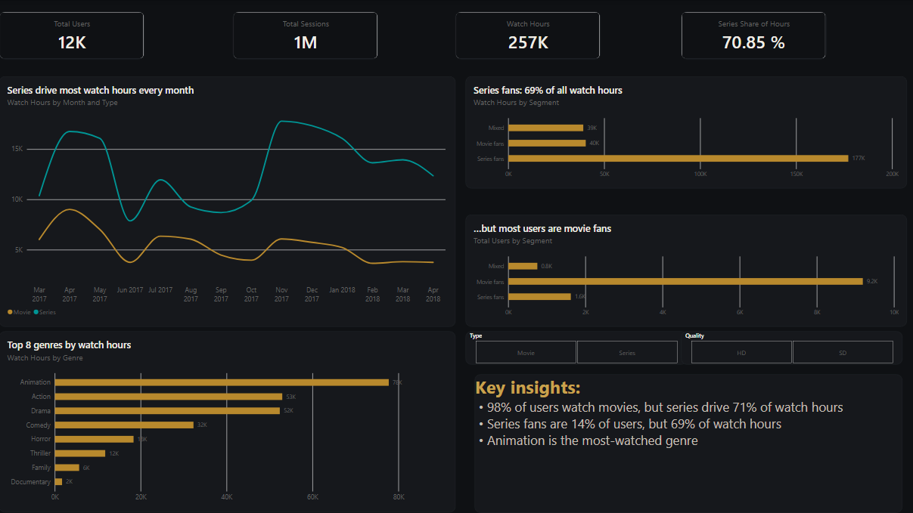

# stc tv: Power BI dashboard

📊 [Download the Power BI file (.pbix)](stc_tv_dashboard.pbix?raw=true)

I already analyzed this data in Python ([stc tv analysis](../stc-tv-analysis)), so I wanted to see the same story in one interactive page that anyone can filter.

The data is about **1M viewing sessions** from **11,578 users** (March 2017 to April 2018).

## What's in the dashboard

- **4 KPI cards:** users, sessions, watch hours, and the share of hours that come from series.
- **Watch hours per month,** movies vs series.
- **Viewer segments:** watch hours and number of users for series fans, movie fans and mixed viewers, next to each other so the gap is easy to see.
- **Top 8 genres** by watch hours.
- **Slicers** for type (movie / series) and quality (HD / SD). Every visual updates together.

## How I built it

- Cleaned the data in Python first, then checked the column types in Power Query.
- Two tables, sessions and users, linked by `UserID` (many to one).
- DAX measures: `Total Users`, `Total Sessions`, `Watch Hours`, `Median Session (min)`, `Series Share of Hours`.
- Sessions longer than 4 hours are kept in the session count but left out of watch hours, the same rule I used in Python.

## Things I fixed along the way

- At first the monthly chart grouped January 2017 with January 2018, which made April look like a huge peak. I changed the axis to a proper month-year column sorted by date.
- My Windows calendar is Hijri, so the months showed in Hijri. I added a `Month` column with `FORMAT(..., "MMM yyyy", "en-US")` to keep them in English.

## Main findings

- 98% of users watch movies, but series make up **71%** of watch hours.
- Series fans are only **14%** of users but **69%** of watch hours.
- With the SD filter on, series go up to **86%** of hours, so the most loyal viewers mostly watch in SD.
- Animation is the most-watched genre.

**Tools:** Power BI Desktop, DAX, Power Query, Python (for cleaning)
